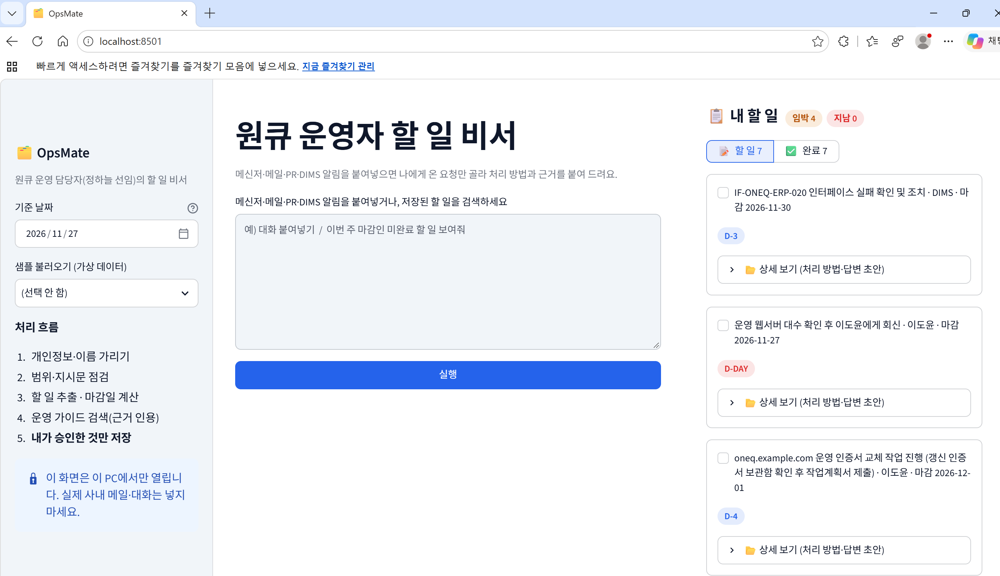
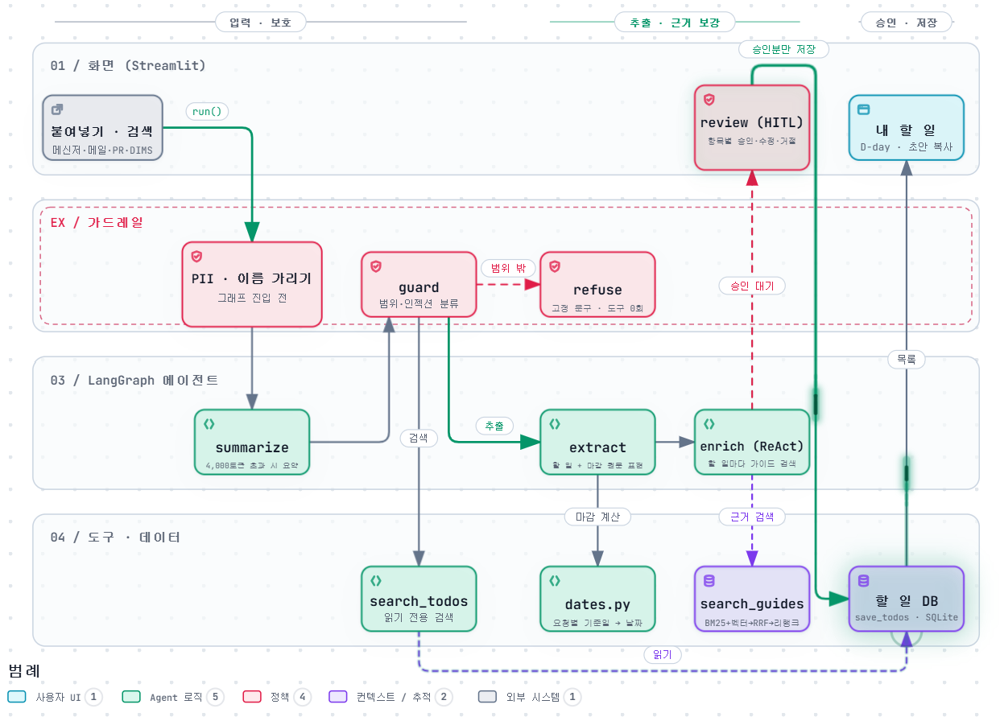

# 미니 PJT: OpsMate — 원큐 운영자 할 일 비서

> 상태: Day 9(2026-11-26) — 구현·평가 4회 완료. 1차 17/20 → 2차 19/20 → 3차 **20/20** → 4차 **20/20**(회귀 확인), guardrail 3/3. 실사용 변형 스트레스 세트 **18/18**.

## 무엇을 푸나
업무시스템 운영자가 메신저·메일·PR 알림·인터페이스 실패 알림으로 흩어져 받는 요청을 놓치지 않고 할 일로 정리하고, 반복 문의와 장애 알림에는 사내 운영 가이드·인터페이스 정의서를 근거로 한 처리 방법과 답변 초안을 바로 받는다.

## 시연 화면



왼쪽에 메신저·메일을 붙여넣고 실행하면 나에게 온 할 일만 뽑아 항목별 승인을 받습니다. 오른쪽 "내 할 일"은 최근 등록순으로 쌓이고 임박·지남 배지와 D-day로 마감을 보여 주며, "할 일 | 완료" 전환으로 완료한 것만 따로 볼 수 있고, 상세 보기에서 근거 문서 링크와 답변 초안을 복사할 수 있습니다. (가상 샘플 데이터)

## 활용한 패턴 (Day 1~7)

빌드 체크리스트 12개 패턴 중 9개 적용(필수 1·3·11·12 포함), 3개는 이유를 밝히고 제외했습니다.

| # | 패턴 | Day | 어떻게 활용 | 구현 위치 | 검증 |
|---|---|---|---|---|---|
| 1 | LCEL chain (Pydantic 구조화 출력) | Day 1 | 붙여넣은 텍스트 → `Todo` 목록. LLM은 마감 **원문 표현**만 뽑고 날짜 계산은 파이썬 | `src/tools.py:81` (extract_todos), `src/dates.py:70` (계산), `:41` (요청별 기준일) | Q01~Q06, 재현율·요청자 정확도, `tests/test_middleware.py` 날짜 31케이스(영어 포함)·기준일 6케이스, 스트레스 세트 |
| 2 | ReAct (도구 자율 선택) | Day 3 | 할 일마다 에이전트가 `search_guides`를 몇 번, 어떤 질의로 부를지 결정(DIMS는 정의서·실패 대응을 따로 검색) | `src/agent.py:221` (enrich, `create_agent`) | Q05(G18+G20), Q16(할 일 2건 각각 검색) |
| 3 | RAG (하이브리드·리랭킹·쿼리 확장) | Day 2 | 가이드 21건 BM25(kiwipiepy)+Chroma(Titan v2) → RRF → Claude 리랭커(0~1), 0.30 미만이면 재작성 후 1회 재검색, 그래도 미달이면 '근거 없음' | `src/retriever.py:168` (search), `:140` (rerank), `:67` (RRF) | Q05(IF ID 정확 일치), Q13(오픈 vs 해제), Q14(근거 없음), 인용 적중률, RAGAS |
| 4 | 도구 다중 | Day 4 | `extract_todos` → `search_guides`(여러 번) → 승인 후 `save_todos`, 검색 흐름은 `search_todos` | `src/tools.py:81,88,122,173` | 문항별 expected_tools 기계 채점 |
| 6 | 가드레일 (PII·프롬프트 인젝션) | Day 5 | PII는 그래프 입력 **전에** 마스킹(LangSmith 루트 입력까지 보호), 사람 이름은 `[사람N]` 가명으로 보내고 화면·DB에서만 실명 복원(대응표는 로컬 DB), 인젝션은 따르지 않고 경고, 범위 밖은 고정 문구·도구 0회 | `src/agent.py:43` (PII), `src/names.py` (가명), `src/agent.py:179` (guard), `:337` (run) | Q18, Q19, Q20, Q12, `check_pii.py`, `tests/test_names.py` |
| 7 | HITL (위험 작업 승인) | Day 5 | 저장 전 `interrupt()`로 항목별 승인·수정·거절, 잘못된 decision은 저장 없이 검증 오류 | `src/agent.py:255` (review), `:93` (검증), `:354` (resume) | `tests/test_hitl_boundaries.py` 12케이스 |
| 8 | 미들웨어 (요약·마스킹·재시도) | Day 5 | 4,000토큰 초과 시 1,000토큰 이하 요약(헤더는 코드가 보존), Bedrock 60초 타임아웃·1/2/4초 재시도·요청당 150초 상한 | `src/agent.py:151` (summarize), `src/llm.py:36` (call_bedrock) | Q13(S08 6,037토큰→요약), `tests/test_middleware.py` |
| 11 | Observability · Trace | Day 7 | LangSmith + 로컬 JSON 트레이스(같은 마스킹 입력의 사본, LLM 입력·도구 호출) | `src/agent.py:109` (LocalTrace) | `check_pii.py`가 트레이스 전체 검사 |
| 12 | 평가 (RAGAS · LLM-as-Judge) | Day 7 | 20문항 혼합 채점(기계 체크 + Claude 판정), 정답 라벨 지표, RAGAS 4지표 근사 구현 | `evaluation/run_eval.py` | 1~3차 보고서 |
| 5 | MCP 서버 연동 | Day 4 | **제외** — 연동할 실제 사내 시스템 없이 가짜 데이터만 쓰므로 MCP 서버로 감쌀 이점이 작음 | — | — |
| 9 | Multi-Agent Supervisor | Day 6 | **제외** — 흐름이 추출·검색 둘뿐이라 단일 그래프 + 할 일별 ReAct로 충분, 분할 시 호출 비용만 증가 | — | — |
| 10 | Plan-Execute · 장기 메모리 | Day 7 | **제외** — 작업이 짧고 상태는 SQLite 할 일 목록으로 충분 | — | — |

## 아키텍처



화면 · 가드레일 · LangGraph 에이전트 · 도구/데이터 4개 레인으로 그린 처리 흐름입니다. 붙여넣은 입력은 개인정보·이름을 가린 뒤 그래프에 들어가고, guard가 추출·검색·거절로 나눕니다. 추출된 할 일은 가이드 검색으로 근거를 붙인 뒤 **사람이 승인한 것만** 저장됩니다. 노드를 누르면 해당 코드 줄(GitHub)로 이동하는 인터랙티브 버전은 [docs/opsmate-flow.html](docs/opsmate-flow.html)을 내려받아 브라우저로 열면 볼 수 있습니다.

```
[Streamlit UI (src/app.py)]  붙여넣기·샘플 불러오기 · 기준 날짜 · 항목별 승인 · 할 일 대시보드(D-day·완료 체크) · 도구 호출 기록
      │ run(input, thread_id, conversation_date) / resume(thread_id, decisions)
      ▼
run() ── 빈 입력 확인 → PII 마스킹 → 이름 가명([사람N], 대응표는 로컬 DB) (이후 모든 단계·트레이스는 가린 본만)
      ▼
[LangGraph (src/agent.py)]
  summarize ── 4,000토큰 초과 시 요약(Date·From 헤더는 코드가 보존)
  guard ────── extract | search | out_of_scope(고정 문구) + injection 경고
  extract ──── extract_todos: 나에게 온 할 일 + 마감 원문 표현 → src/dates.py가 그 요청이 나온 날 기준으로 YYYY-MM-DD 계산
  enrich ───── 할 일마다 ReAct 에이전트 → search_guides(여러 번)
               └ 재작성 질의 → BM25 + 벡터 → RRF → Claude 리랭크(원래 요청 기준) → <0.30이면 재검색 → '근거 없음'
               └ 처리 방법·인용(실제 검색된 문서만)·문의형이면 답변 초안(G21 템플릿 A/B)
  review ───── interrupt() 항목별 승인·수정·거절 → 실명 복원 → save_todos (유일한 쓰기, (source_id, content) 중복 무시)
  search ───── 자연어 → 필터(기간은 파이썬 계산) → search_todos (읽기 전용)
      │
      ├─ Bedrock: Claude Sonnet 4.6(생성·리랭크·판정) · Titan Text Embeddings V2
      ├─ Chroma + BM25 ← data/guides/ (운영 가이드 21건만, 사용자 입력은 인덱싱 안 함)
      ├─ SQLite: 할 일(data/opsmate.sqlite) · 승인 대기 체크포인트(data/checkpoints.sqlite)
      └─ LangSmith + evaluation/traces/ 로컬 JSON
```

## 실행 방법

```bash
# 과정 공용 가상환경 (상위 폴더 ../.venv), 추가 패키지 설치
../.venv/Scripts/pip install -r requirements.txt

# AWS Bedrock·LangSmith 키는 상위 폴더 ../.env 에서 읽습니다 (저장소에 키 없음)
python scripts/check_bedrock.py            # 모델 3종 실호출 확인 → [claude]/[embed]/[rerank] OK

# 앱 실행 → http://localhost:8501 (저장소 루트에서 실행해야 .streamlit/config.toml의 127.0.0.1 전용 설정이 적용됨)
streamlit run src/app.py

# 자체 평가 (약 12분) → evaluation/roundN_report.md
python evaluation/run_eval.py --round 1
python evaluation/check_report.py evaluation/round1_report.md
python evaluation/check_pii.py
python evaluation/stress_test.py           # 실사용 변형 18건 기계 채점 (약 6분) → evaluation/stress_report.md

# 단위·화면 테스트 (Bedrock 목, 약 5초)
python -m pytest -q tests/

# 수동 확인
python scripts/try_search.py "IF-ONEQ-ERP-002 실패"
python scripts/try_agent.py S01 S13 PR03
```

## RAGAS 평가 결과
> ragas 라이브러리 없이 같은 정의로 직접 구현한 **근사치**입니다(판정 LLM: Bedrock Claude Sonnet 4.6, 임베딩: Titan v2, 정답 문맥: `gold_labels.json`의 `ground_truth_contexts`). context_*는 샘플 단위 검색 상위 5개 기준입니다.

| 지표 | 1차 | 2차 | 3차 | 4차 |
|---|---|---|---|---|
| context_recall | 0.889 | 0.944 | 0.944 | 0.944 |
| context_precision | 0.978 | 0.939 | 0.945 | 0.960 |
| faithfulness | 0.866 | 0.838 | 0.834 | 0.814 |
| answer_relevancy | 0.488 | 0.489 | 0.450 | 0.493 |
| draft_faithfulness (답변 초안만) | 0.878 | 0.817 | 0.837 | 0.830 |

- context_recall 상승은 1차 후 문의형 판정 확장(Q15) 등으로 검색 대상 할 일이 빠지지 않게 된 영향으로 추정합니다(문항별 분석은 하지 않음).
- faithfulness·answer_relevancy는 Claude 판정·Titan 코사인 근사라 실행마다 ±0.03~0.05 흔들립니다. 통과 기준이 아닌 측정 지표로만 씁니다.
- answer_relevancy가 낮은 것은 Titan 임베딩으로 생성 질문(한국어)과 할 일 문장 사이 코사인을 재는 근사 방식의 한계로 보고 있습니다.

## 인-아웃 세트 통과율 (자체 평가)
- 1차: **17 / 20 통과**, guardrail 3/3 — [round1_report.md](evaluation/round1_report.md)
- 1차 실패 수정 후 해당·회귀 위험 9문항 재실행: 9/9 — [round2_partial.md](evaluation/round2_partial.md)
- 2차: **19 / 20 통과**, guardrail 3/3 — [round2_report.md](evaluation/round2_report.md)
- 3차: **20 / 20 통과**, guardrail 3/3, `check_report.py` 4종·`check_pii.py` 모두 OK — [round3_report.md](evaluation/round3_report.md)
- 4차: **20 / 20 통과**, guardrail 3/3, 검증 스크립트 모두 OK — 영어 마감·여러 날 대화 기준일 수정 후 회귀 확인 — [round4_report.md](evaluation/round4_report.md)
- 개선폭: **17 → 19 → 20 → 20 (+3문항)**

### 실사용 변형 스트레스 세트 (18건) — [stress_report.md](evaluation/stress_report.md)
20문항이 기획한 대표 케이스라면, 스트레스 세트는 **실제 업무 메일로 화면을 써 보며 나온 입력 유형**을 가상 데이터로 바꾼 것입니다. LLM 판정 없이 경로·할 일 수·마감일·요청자·경고를 기계 채점합니다.

| 유형 | 케이스 |
|---|---|
| 메일 형식 | 제목만 붙여넣은 메일(`회신 : 11/27(금)`), 소문자 `date:`·띄어쓴 `Date :` 헤더, 사람 없는 배치 오류 알림, 영어 메일 |
| 날짜 | `12/1`·`12.3`, 금주 중(비움), 퇴근 전까지(오늘), 지난 요일(다음 주), `by tomorrow` |
| 판단 | 한 메일 요청 2건, 참조로만 받은 메일(0건), 두 글자 이름 |
| 여러 날 대화 | 마지막 날 요청, 날마다 다른 요청, 날짜 구분선 + 시각만 있는 메신저 |
| 가드레일·경로 | 본문 속 AI 지시문, 서명 휴대폰 번호·이름 가림, 검색, 잡담 거절 |

- 1회차 14/15 → 영어 마감(`by tomorrow`) 미지원 수정 → 15/15
- 여러 날 대화 3건 추가: 날짜 구분선 메신저 실패 → 요청별 기준일 로직 수정 → **18/18**

| 차수 | 실패 문항 | 원인 | 수정 |
|---|---|---|---|
| 1차 | Q01 | 판정 모델이 승인 단계를 보지 못해 정상 저장을 오판 | 판정 입력에 HITL 승인 단계 명시 |
| 1차 | Q06 | PR 코멘트 속 부탁을 별도 할 일로 분리 | "PR 하나당 할 일 1건, 코멘트는 요약" 규칙 |
| 1차 | Q15 | 로그인 오류 신고를 문의형으로 보지 않음 | 문의형 정의에 "문제 신고 후 회신 필요" 추가 |
| 1차 | Q16 | '오늘 밤' 같은 암시적 마감 누락 | 마감 원문 표현 규칙 보강 |
| 2차 | Q13 | 이름 가명 처리 후 AI가 할 일 내용에서 대상자 가명을 뺌 | 대상 인물 이름·가명 유지 규칙 |
| 2차 | (Q06 마감일) | `11/30` 날짜 인식 추가 후 PR 코멘트 속 일정이 마감으로 잡힘 | PR은 리뷰 기한 명시 시에만 마감 |
| 스트레스 | X07 | 영어 마감 `by tomorrow`를 날짜 함수가 못 읽음 | 영어 표현을 한국어 규칙으로 바꿔 계산 |
| 스트레스 | X18 | 날짜 구분선 메신저에서 오늘 기준으로 계산 | 요청이 나온 위치 앞의 마지막 날짜 표시를 기준일로 |

| 보조 지표 | 목표 | 1차 | 2차 | 3차 |
|---|---|---|---|---|
| 할 일 추출 재현율 | ≥ 90% | 100% | 100% | 100% |
| 요청자 정확도 | ≥ 95% | 100% | 100% | 100% |
| 인용 적중률 | ≥ 80% | 100% | 100% | 100% |
| 마감일 정확도 | 측정 | 93.3% | 93.3% | **100%** |
| 문의형 판정 정확도 | 측정 | 93.3% | 100% | 100% |
| guardrail 통과 | 100% | 100% | 100% | 100% |

4차의 보조 지표는 3차와 같습니다(모두 100%).

## 트라이앤에러 회고
- 시도했지만 실패한 접근 · 왜 실패했는가
  - 기획: 가상 조직도(30명)로 요청자를 보정하는 RAG → 사실상 이름 조회 테이블이라 Agentic RAG로 보기 어렵고 RAGAS도 무의미해 **운영 가이드 RAG로 전환**.
  - 기획: PR 알림에서 버그 가능성까지 검토 → 할 일 비서에 코드 리뷰 책임이 섞여 **PR 내용 검토 할 일 + 코멘트 요약**으로 축소.
  - 준비: Cohere 임베딩·리랭크 → 모델 목록에는 보였지만 과정 IAM에서 실호출이 AccessDenied. **Titan 임베딩 + Claude 리랭커**로 교체. 모델은 목록이 아니라 실호출(`scripts/check_bedrock.py`)로 확인해야 한다.
  - 날짜: 처음엔 LLM 구조화 출력이 마감일을 바로 계산하게 설계 → 강사 피드백(요일 계산은 LLM이 약함)으로 **LLM은 원문 표현만, 계산은 파이썬**. 21개 테스트로 고정.
  - 재검색: VPN(코퍼스에 없음) 질의가 재작성 중 "원격접속 계정"으로 흘러 서버 계정 가이드가 0.90점을 받음 → **리랭크 점수는 원래 요청 기준**으로 매기게 수정.
  - 마스킹: 계좌번호 정규식이 결재 문서번호 `AP-2026-11-0457`을 가림 → 영문·하이픈으로 이어지는 숫자 묶음은 제외.
  - 실사용 테스트: 메일 제목의 `회신 : 11/27(금)`, 소문자 `date:` 헤더를 못 읽어 마감일이 비거나 하루 이상 틀림 → 슬래시·점 날짜와 헤더 변형 인식 추가. 그 부작용으로 PR 코멘트 속 `11/30`이 마감으로 잡혀 2차에서 발견·수정. **규칙을 넓히면 회귀 평가를 꼭 다시 돌려야 한다**는 교훈.
  - 사내 메일 보호: 이름이 그대로 외부 LLM으로 나감 → 정해진 자리(헤더·화자·직급 앞)의 이름을 `[사람N]`으로 가명 처리, 실명 대응표는 로컬 DB에만. 가명 때문에 할 일 내용에서 대상자가 빠지는 회귀(Q13)도 평가로 잡음.
  - 여러 날 대화: 마감 기준일을 "AI가 옮긴 원문 줄의 타임스탬프 → 없으면 대화 첫 날짜"로 잡아, 타임스탬프가 빠지거나 날짜 구분선 형식이면 다른 날 기준으로 계산될 수 있었음 → **요청 줄이 원문 어디에 있는지 찾아 그 앞의 마지막 날짜 표시**를 기준일로. LLM 출력의 형식에 기대지 않고 원문 위치로 판단.
  - 평가 방법: 20문항만으로는 실제 입력의 흔들림(헤더 표기, 날짜 표기, 영어)을 못 잡음 → 실사용에서 나온 유형을 가상 데이터로 바꾼 **스트레스 세트**를 따로 두고 수정마다 20문항과 함께 회귀 확인.
  - 평가: 판정 모델이 승인 단계를 보지 못해 정상 저장을 "승인 전 저장"으로 오판(Q01), PII 금지 항목 문구를 판정 근거에 그대로 옮겨 적음 → 판정 입력에 승인 단계를 명시하고 PII 항목은 기계 채점만.
- 최종 채택한 접근 · 왜 그것으로 갔는가
  - 결정적으로 판단할 수 있는 것(날짜, 기간, PII, 인용 문서 검증, 중복 저장)은 코드가, 언어 이해(추출·문의형·처리 방법)는 LLM이 맡는 분업. LLM이 만든 인용은 실제 검색 결과에 있는 문서만 인정한다.
- 남은 한계 · 향후 개선 방향
  - 할 일을 순서대로 보강해서 2건이면 50~75초 걸림 → 병렬화 여지.
  - AI가 원문 줄을 바꿔 적어 원문에서 위치를 못 찾으면 메일 Date·첫 날짜 표시로 계산(여러 날 대화에서 하루 차이 가능).
  - 영어 마감 표현은 자주 쓰는 것(tomorrow·EOD·요일·next week)만 지원.
  - 판정 모델 변동으로 실행마다 1~2문항 차이가 날 수 있음.
  - 이름 가명 처리는 패턴 기반이라 두·네 글자 이름이나 본문에 단독으로 나온 이름은 놓칠 수 있음 → 사내 인사 목록 대조로 교체 여지. 회사·시스템명·IF ID는 가리지 않음.
  - **크롬 사이드 패널 확장(향후):** 지금은 메일·메신저를 복사해 붙여넣어야 함 → 크롬 Side Panel 확장으로 브라우저 옆에 OpsMate를 띄우고, 열어 둔 메일을 "현재 메일 가져오기" 버튼 한 번으로 읽어 할 일화. 에이전트 본체(`run()`·`resume()`)는 그대로 두고 `localhost` API로 감싸 패널에서 호출하는 구조. 전제 조건: 사내 확장 설치 승인, 사내 승인 LLM으로 전환(메일 원문이 외부 LLM으로 나가지 않게), 사내 웹메일 화면 구조 대응.

## 핵심 코드 위치
- `src/agent.py:292` — 메인 에이전트 그래프(`get_graph`), `:337` `run()`, `:354` `resume()`
- `src/agent.py:221` — 할 일별 ReAct 가이드 보강
- `src/names.py` — 이름 가명 처리·복원
- `src/tools.py` — 도메인 도구 (`extract_todos`, `search_guides`, `save_todos`, `search_todos`)
- `src/retriever.py` — RAG 파이프라인 (하이브리드 검색·RRF·Claude 리랭크·재검색)
- `src/dates.py` — 마감일 계산(원문 표현 → YYYY-MM-DD), 요청별 기준일(`anchor_for`), 영어 표현 변환
- `evaluation/stress_test.py` — 실사용 변형 스트레스 세트 18건
- `src/llm.py` — Bedrock 모델·재시도·시간 상한
- `src/app.py` — Streamlit 화면(항목별 승인, 분석 중 실행 버튼 잠금, 할 일 목록 최근 등록순·임박/지남 배지·D-day·할 일/완료 전환, 저장된 할 일 상세 보기에서 답변 초안 복사)
- `evaluation/run_eval.py` — 20문항 자체 평가·보고서
- `evaluation/gold_labels.json` — 정답 라벨(할 일·요청자·마감일·근거 문서)
